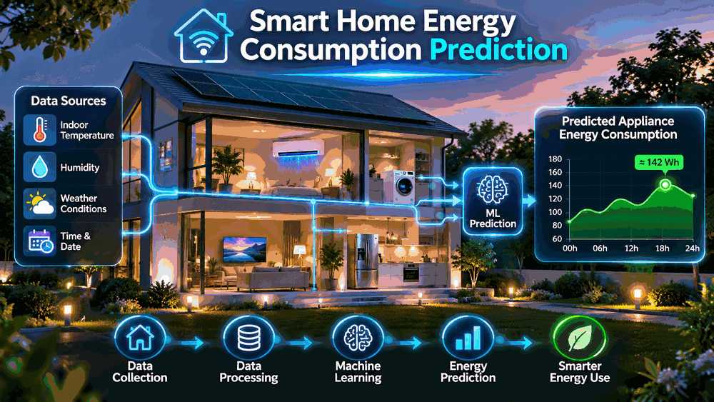

# Smart Home Energy Consumption Prediction

### Predicting Household Appliance Energy Consumption Using Machine Learning and Deep Learning



## Project Overview

This project investigates household appliance energy consumption using environmental sensor measurements, outdoor weather conditions, historical energy usage, and time-related features.

The primary objective is to develop and evaluate machine learning and deep learning models capable of predicting household appliance energy consumption **10 minutes ahead**.

The project covers exploratory data analysis, feature engineering, chronological train/test splitting, forecasting model development, performance evaluation, and model interpretation.

## Project Objectives

- Explore household appliance energy consumption patterns and trends.
- Investigate the relationships between electricity consumption, indoor environmental conditions, and outdoor weather variables.
- Engineer historical consumption and time-related features for short-term forecasting.
- Develop and compare statistical, machine learning, and deep learning forecasting models.
- Evaluate prediction accuracy and investigate forecasting errors.
- Identify opportunities for improving smart home energy monitoring and demand prediction.

## Dataset

**Source:** [UCI Machine Learning Repository — Appliances Energy Prediction](https://archive.ics.uci.edu/dataset/374/appliances+energy+prediction)

The dataset contains **19,735 observations and 29 columns**, including:

- Appliance energy consumption (Wh)
- Indoor temperature and humidity measurements
- Outdoor weather conditions
- Lighting energy consumption
- Date and time information

Measurements were recorded at **10-minute intervals between January and May 2016**.

The original dataset is excluded from this repository and can be downloaded from the UCI Machine Learning Repository.

## Technologies Used

- Python
- Jupyter Notebook
- Pandas and NumPy
- Matplotlib and Seaborn
- Scikit-learn
- XGBoost
- TensorFlow / Keras
- Git and GitHub

## Project Methodology

### 1. Data Exploration and Quality Assessment

The dataset was examined for missing values, timestamp continuity, descriptive statistics, consumption distributions, daily and hourly trends, and relationships between energy consumption and environmental variables.

### 2. Feature Engineering and Data Preparation

Historical appliance consumption, lagged consumption values, rolling averages, and time-related variables were prepared for forecasting.

The prediction target was constructed by shifting appliance consumption one observation ahead, representing a **10-minute forecasting horizon**.

A chronological train/test split was used to preserve the time ordering of observations.

### 3. Forecasting Model Development

Seven forecasting configurations were evaluated:

1. Persistence Baseline
2. Linear Regression
3. Random Forest
4. Regularized Random Forest
5. XGBoost
6. Regularized XGBoost
7. Long Short-Term Memory (LSTM)

### 4. Model Evaluation

Model performance was evaluated using:

- Mean Absolute Error (MAE)
- Root Mean Squared Error (RMSE)
- Coefficient of Determination (R²)

The final model comparison used aligned test observations to support a fair evaluation.

## Forecasting Results

| Model | MAE (Wh) | RMSE (Wh) | R² |
|---|---:|---:|---:|
| Linear Regression | 26.63 | 59.83 | 0.5627 |
| Regularized XGBoost | 26.20 | 60.54 | 0.5523 |
| LSTM | 27.79 | 63.11 | 0.5135 |
| Persistence Baseline | 26.52 | 66.23 | 0.4641 |
| Regularized Random Forest | 41.00 | 71.28 | 0.3793 |
| Random Forest | 58.36 | 91.76 | -0.0285 |
| XGBoost | 90.62 | 112.15 | -0.5365 |

**Key findings:**

- Linear Regression achieved the lowest RMSE and highest R², making it the best-performing model under these criteria.
- Regularized XGBoost achieved the lowest MAE.
- Linear Regression, Regularized XGBoost, and LSTM outperformed the Persistence Baseline in RMSE.
- Regularization substantially improved the performance of Random Forest and XGBoost compared with their original configurations.
- Sudden increases in appliance consumption remained challenging to predict.

These results are specific to the dataset, forecasting horizon, and evaluation approach used in this project.

## Model Interpretation and Diagnostics

The project also examined:

- Actual versus predicted appliance energy consumption
- Residuals versus predicted consumption
- Distribution of forecasting errors
- Linear Regression feature coefficients and standardized coefficients
- Verification of the one-step-ahead forecasting alignment

The diagnostic results indicate that recent consumption patterns are useful predictors, although forecasting accuracy decreases during abrupt demand changes.

## Repository Structure

```text
Smart_Home_Energy_Consumption_Prediction/
├── data/
├── figure/
│   ├── appliance_energy_distribution.png
│   ├── daily_appliance_energy_trends.png
│   ├── hourly_appliance_energy_profile.png
│   ├── final_model_rmse_comparison.png
│   ├── actual_vs_predicted_linear_regression.png
│   ├── linear_regression_residual_analysis.png
│   ├── linear_regression_residual_distribution.png
│   └── smart_home_energy_prediction_3d_animation.gif
├── notebook/
│   └── Smart_Home_Energy_Consumption_Prediction.ipynb
├── .gitignore
├── README.md
└── requirements.txt
```

The `figure/` directory also contains additional visualizations generated during exploratory analysis.

## Getting Started

### 1. Clone the Repository

```bash
git clone https://github.com/damisar/Smart_Home_Energy_Consumption_Prediction.git
cd Smart_Home_Energy_Consumption_Prediction
```

### 2. Install Dependencies

```bash
pip install -r requirements.txt
```

### 3. Download the Dataset

Download the Appliances Energy Prediction dataset from the UCI Machine Learning Repository.

Create a local `data/` directory if it does not already exist, and place the downloaded CSV file inside it using this filename:

```text
UCI Appliances Energy Prediction_energydata_complete.csv
```

### 4. Run the Notebook

Open the Jupyter Notebook:

```text
notebook/Smart_Home_Energy_Consumption_Prediction.ipynb
```

Run the cells sequentially to reproduce the data exploration, forecasting models, evaluation, and diagnostic visualizations.

## Recommendations and Future Work

Potential improvements include:

- Improving prediction accuracy during sudden consumption peaks.
- Evaluating the models using additional households and longer datasets.
- Exploring longer forecasting horizons, such as 30 minutes and one hour.
- Investigating additional feature selection and hyperparameter optimization approaches.
- Integrating the forecasting model into a practical smart home energy monitoring dashboard.

## Project Status

**Completed — Exploratory Data Analysis, Feature Engineering, Forecasting, Model Evaluation, Diagnostics, and Conclusions.**

The project demonstrates how historical energy consumption, environmental measurements, and time-related information can support short-term household appliance energy forecasting.